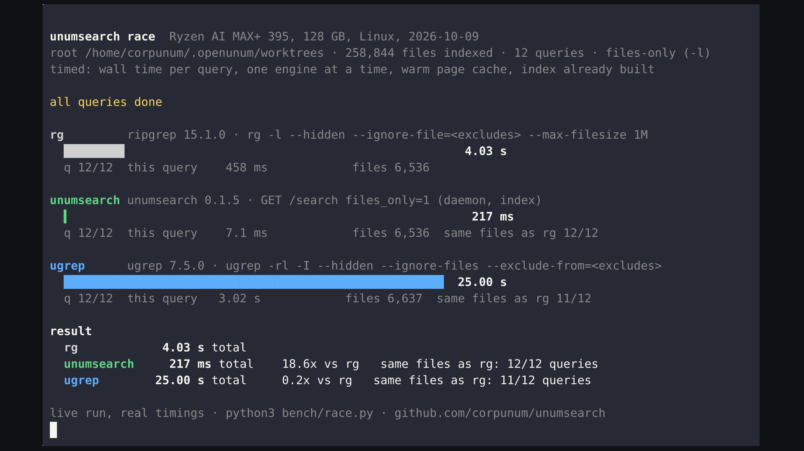
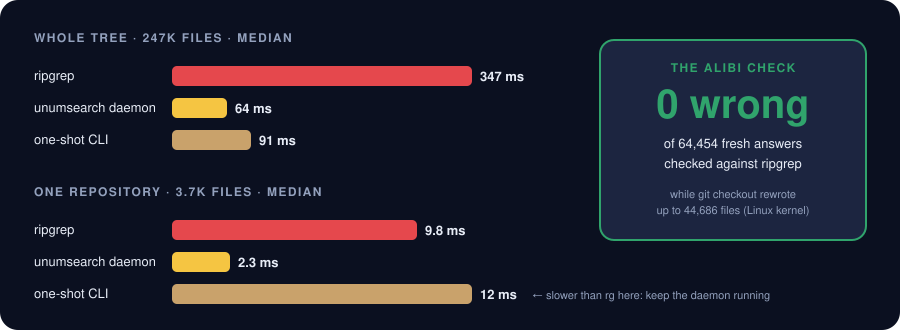

<div align="center">

# 🔍 unumsearch

**The detective for your code. Your AI agents search the same files all day; unumsearch keeps the clues.**

[](https://github.com/corpunum/unumsearch/actions/workflows/ci.yml) [](https://github.com/corpunum/unumsearch/releases) [](LICENSE) 


</div>

## The case in 30 seconds

An AI coding agent asks the same kind of question hundreds of times a day: *where is this
function called? which files mention that setting?* A plain search like `rg` answers by reading
**every file, every time**. Over dozens of checkouts that is gigabytes per question.

unumsearch works like a detective with a good notebook. It keeps a compact **index of clues**:
every 3-letter piece of text and the files it appears in. A question becomes a set of clues, the
index names the few **suspect** files that hold all of them, and only those are opened and
**checked line by line** against the real file. Same answer as ripgrep, usually in milliseconds.

## Watch the race


*Live run, real timings: 12 search patterns our agents actually issued, over ~180 agent worktrees
(258k files), one engine at a time with a warm page cache. Nothing is replayed or sped up. Run it on
your own code with `python3 bench/race.py --root .` ([see it yourself](docs/BENCHMARKS.md#see-it-yourself)).*

<details>
<summary>Final result card</summary>



</details>

## How the detective works



- **Never silently stale.** A file watcher notices every edit; changed files are searched directly
  until the index catches up (usually well under a second). Every answer says whether it is `fresh`.
- **Never guesses.** The index only narrows which files to read; the answer always comes from
  the real file contents, with the same file rules as ripgrep (`.gitignore`, hidden files,
  binaries and size cap).
- **Never peeks at secrets.** `.ssh/`, `.aws/`, `.env*`, `*.key`, `*.pem`, `secrets.json` and
  other credential files are never indexed, whatever the configuration says.
- **Travels light.** No GPU, no model, no network. One static binary; the index is a memory-mapped
  file the OS can page out.

## The evidence



20 regexes mined from a week of real coding-agent tool calls, on the author's machine
(2026-10-09). Honest notes:

- **Keep the daemon running.** The speed comes from a process that keeps the index open (the
  daemon, MCP server or `rpc`). A *new CLI process per query* is slower than `rg` on a small
  repository (12 ms vs 9.8 ms).
- **Same answers.** 19 of 20 queries returned exactly rg's files over the whole tree; the 20th
  differs only by `.env.example` files, which unumsearch never indexes on purpose.
- **Branch switches.** When `git checkout` rewrites 44,686 Linux kernel files, the index has caught
  up 6.4 to 7.5 s after the checkout began; until then answers say `fresh: false`, so an agent
  can fall back to its own scan. 0 of 64,454 fresh answers differed from ripgrep.

Method, every table and the weak spots: [docs/BENCHMARKS.md](docs/BENCHMARKS.md). What is
guaranteed and how it is tested: [RELIABILITY.md](RELIABILITY.md).

## Try it in one minute

```bash
curl -fsSL https://github.com/corpunum/unumsearch/releases/latest/download/install.sh | sh
```

```powershell
irm https://github.com/corpunum/unumsearch/releases/latest/download/install.ps1 | iex
```

```bash
unumsearch --root ~/src/myrepo index                  # build the index once
unumsearch search 'fn\s+main' ~/src/myrepo --text      # ask a question
unumsearch --root ~/src/myrepo serve                  # keep it fresh + serve the local API
```

Static binaries for Linux (x86_64, aarch64), macOS (arm64, x86_64) and Windows (x86_64), each
verified against `SHA256SUMS` with a build-provenance attestation. Config file, systemd unit and
building from source: [Reference → Install](docs/REFERENCE.md#install).

## Hand it to your agent

| Agent or tool | How |
|---|---|
| **Claude Code** | `claude mcp add unumsearch -- unumsearch mcp`, or the skill in `~/.claude/skills/` |
| **OpenAI Codex CLI** | `codex mcp add unumsearch -- unumsearch mcp` |
| **Gemini CLI** | `gemini mcp add unumsearch unumsearch mcp` |
| **Cursor, VS Code / Copilot, Windsurf, Cline, Roo Code, Continue, Zed** | stdio MCP server `unumsearch mcp` |
| **OpenCode, Goose, Hermes Agent, OpenClaw** | MCP (OpenClaw: also the skill) |
| **Pi** | the Agent Skill (Pi has no MCP by design) |
| **Aider** | `/run unumsearch search --text PATTERN DIR` |
| **OpenUnum** | built in: its search tools use the daemon and fall back on their own |
| **Anything else** | local HTTP/JSON API, stdio JSON-RPC or plain CLI with JSON output |

Checked, per-tool setup: [docs/integrations](docs/integrations/README.md).

<details>
<summary><b>🕵️ For engineers: the toolkit in one table</b></summary>

| Front-end | What it gives you |
|---|---|
| `unumsearch search PATTERN [PATH]` | content search: regex or `-F` literal, `-i`, `-g GLOB`, `-l`, `--text` |
| `unumsearch files [PATH]` | filename search: globs, `--regex`, `--fuzzy` with optional frecency |
| `unumsearch serve` | watcher + HTTP API on `127.0.0.1:7781` (`/search`, `/files`, `/lookup`, `/status`, `/rpc`) |
| `unumsearch rpc` / `mcp` | JSON-RPC 2.0 or MCP over stdio (`search`, `find_files`, `index_status`) |
| Rust library | `Engine::open`, `engine.search(...)`, `watch::run`, `api::call` |

Every answer is JSON with `backend` (`index`/`scan`), `covered`, `fresh`, `truncated` and
`complete`, so a client knows exactly when to trust it and when to scan itself. Inside: per-unit
trigram shards with delta/varint postings and a next-byte mask, a regex-to-trigram planner, and
incremental rebuilds that re-read only changed files. Details: [Reference → How it works](docs/REFERENCE.md#how-it-works).

</details>

<details>
<summary><b>🔒 Case rules: what it will not do</b></summary>

- Index or scan secret locations (`.ssh`, `.gnupg`, `.aws`, `.config`, `.kube`, `.env*`, keys,
  credential files), from any front-end.
- Answer the HTTP API for directories outside its configured roots, or for foreign `Host` headers.
- Listen beyond loopback without a token (`auth_token` / `UNUMSEARCH_TOKEN`).
- Call a model or open an outbound connection.

Full list: [Reference → Security](docs/REFERENCE.md#security).

</details>

## Learn more

[Reference](docs/REFERENCE.md) (every option, API, FAQ) · [Benchmarks](docs/BENCHMARKS.md) ·
[Reliability](RELIABILITY.md) · [Integrations](docs/integrations/README.md) ·
[Changelog](CHANGELOG.md) · [Agent Skill](skills/unumsearch/SKILL.md)

<sub>Apache-2.0 (includes the MPL-2.0 `nucleo-matcher` dependency) · built by [corpunum](https://github.com/corpunum) · sibling project:
[UnumPingPong](https://github.com/corpunum/unumpingpong) (AI agents rally on your tasks; a referee decides who scores)</sub>
